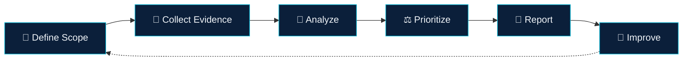

<!--
  GitHub Profile README
  Name: Abdelfatah Abdelhamed — DEBO
  PROGRAMMER BY : ABDELFATAH ABDELHAMED - DEBO
  ⚠️ استبدل YOUR_USERNAME باسم حسابك على GitHub في كل الأماكن
-->

<div align="center">


<a href="https://git.io/typing-svg">
  
</a>

<br/>


<br/><br/>

<a href="https://www.facebook.com/share/18hTuwj372/?mibextid=wwXIfr">
  
</a>
<a href="https://www.instagram.com/xxdebo_/">
  
</a>

</div>

---

## ⚡ `root@debo:~# cat about.txt`

```bash
┌──[debo@4t-recon]─[~/profile]
└─$ cat identity.json
{
  "name"     : "Abdelfatah Abdelhamed",
  "alias"    : "DEBO",
  "role"     : "Cybersecurity Tool Developer",
  "focus"    : ["Attack Surface Analysis", "Recon", "Security Automation", "Defensive Engineering"],
  "stack"    : ["Python", "Bash", "Linux", "SQLite"],
  "ethics"   : "Authorized testing only",
  "mission"  : "Turn technical observations into actionable security insights",
  "status"   : "Building in public 🚀"
}
```

> 🛡️ I build tools that help security practitioners **see their environment clearly**, **find configuration weaknesses**, **organize evidence**, and **prioritize remediation**.

---

## 🎯 Engineering Principles

<div align="center">

| 🔍 Evidence > Assumptions | ⚙️ Automation With Purpose | 🔐 Security By Design | 🧾 Transparency | ⚖️ Responsible Research |
|:--:|:--:|:--:|:--:|:--:|
| Every finding has a technical basis | Repeatable, efficient workflows | Validate inputs, least privilege, fail safely | Confirmed ≠ needs verification | Authorized scope only |

</div>

---

## 🧰 Tech Arsenal

<div align="center">


<br/><br/>


</div>

---

## 🚀 Featured Project

<div align="center">

# 🛰️ 4T-RECON

### Defensive Attack Surface Intelligence CLI


</div>

```text
   ╔════════════════════════════════════════════════════╗
   ║   4T-RECON  ::  Defensive Attack Surface Intel     ║
   ║   PROGRAMMER BY : ABDELFATAH ABDELHAMED - DEBO     ║
   ╚════════════════════════════════════════════════════╝
```

| 🧩 Module | 📌 What it does |
|:--|:--|
| 🌐 **DNS Recon** | Collects DNS records and asset information |
| 🔒 **TLS / HTTPS** | Assesses certificates and HTTPS configuration |
| 🧱 **Security Headers** | Analyzes headers and gives remediation guidance |
| 🕵️ **Passive Subdomains** | Optional passive subdomain intelligence |
| 🧾 **Evidence-based Findings** | Structured findings with documented evidence |
| 📈 **Scan History** | Local history + comparison between assessments |
| 📤 **Reports** | JSON, CSV, and HTML outputs |
| 🧪 **Quality** | Defensive defaults, automated tests, modular design |

> ⚠️ **Development status:** features are considered available only when implemented and tested in the published repository.

---

## 🧠 How I Work



> The goal isn't the **largest number of alerts** — it's **useful, explainable, actionable** results. A missing indicator is never automatically proof of a vulnerability.

---

## 📊 GitHub Stats

<div align="center">


</div>

---

## 🛠️ Development Standards

<details>
<summary><b>Click to expand 🔽</b></summary>

<br/>

- ✅ Modular architecture and maintainable source code
- ✅ Clear installation and usage instructions
- ✅ Input validation and secure error handling
- ✅ Unit tests and repeatable test procedures
- ✅ Structured logging and machine-readable outputs
- ✅ Explicit documentation of assumptions and limitations
- ✅ Least-privilege operation wherever possible
- ✅ Responsible handling of discovered vulnerabilities and sensitive data

</details>

## 🎯 Current Mission

- 🔧 Developing practical cybersecurity command-line tools
- 🛰️ Improving reconnaissance and security-assessment workflows
- 🧠 Studying attack patterns from a defensive analysis perspective
- 📦 Building reproducible security checks and risk-reporting pipelines
- 🌍 Publishing documented projects the community can review, test, and improve

---

## 🤝 Let's Connect

<div align="center">

Open to **cybersecurity engineering**, **defensive tooling**, **automation**, and **technical collaboration**.

<a href="https://www.facebook.com/share/18hTuwj372/?mibextid=wwXIfr">
  
</a>
<a href="https://www.instagram.com/xxdebo_/">
  
</a>

<br/><br/>

> ⚖️ *All tools and research are intended for **authorized, defensive and educational use only**.*

<br/>

**PROGRAMMER BY : ABDELFATAH ABDELHAMED - DEBO**

<a href="https://git.io/typing-svg">
  
</a>


</div>
