<!--
  GitHub Profile README
  Abdelfatah Abdelhamed — DEBO
  PROGRAMMER BY : ABDELFATAH ABDELHAMED - DEBO
  TODO: replace YOUR_USERNAME, YOUR_EMAIL, YOUR_LINKEDIN before publishing
-->

<div align="center">


<a href="https://git.io/typing-svg">
  
</a>

<br/>


</div>

---

## `>_` OPERATOR PROFILE

```yaml
┌──────────────────────────────────────────────────────────────┐
│  CLASSIFICATION : PUBLIC                                     │
│  CODENAME       : DEBO                                       │
│  REAL NAME      : Abdelfatah Abdelhamed                      │
│  ROLE           : Cybersecurity Analyst & Security Tool Dev  │
│  SPECIALTY      : Attack Analysis · Attack Surface · Recon   │
│  MINDSET        : Think like an attacker, defend like a pro  │
│  OS OF CHOICE   : Kali Linux                                 │
│  RULES OF ENGAGEMENT : Authorized targets only               │
│  STATUS         : ACTIVE — building & hunting                │
└──────────────────────────────────────────────────────────────┘
```

> **I study how attacks happen so organizations can stop them.**
> My work sits at the intersection of **attack analysis**, **attack-surface intelligence**, and **security automation** — turning scattered technical signals into clear, evidence-backed findings that teams can act on.

---

## `01` // WHAT I DO

<div align="center">

| 🎯 CAPABILITY | ⚔️ WHAT IT MEANS IN PRACTICE |
|:--|:--|
| **Attack Analysis** | Breaking down attack techniques, mapping them to adversary behavior, and identifying where defenses fail |
| **Attack Surface Intelligence** | Discovering and mapping exposed assets, services, and misconfigurations |
| **Reconnaissance** | DNS intelligence, passive subdomain discovery, service fingerprinting |
| **Web & TLS Security Review** | HTTP security headers, certificate posture, HTTPS hardening |
| **Threat Hunting Mindset** | Hypothesis-driven analysis, correlating weak signals into real findings |
| **Security Tool Development** | Python/Bash CLI tools with modular design, tests, and structured output |
| **Risk & Reporting** | Evidence-based findings, impact prioritization, actionable remediation |

</div>

---

## `02` // FEATURED OPERATION

<div align="center">

# 🛰️ 4T-RECON

### Defensive Attack Surface Intelligence Framework


</div>

```text
  ╔═══════════════════════════════════════════════════════╗
  ║  4T-RECON  //  ATTACK SURFACE INTELLIGENCE CLI        ║
  ║  PROGRAMMER BY : ABDELFATAH ABDELHAMED - DEBO         ║
  ╚═══════════════════════════════════════════════════════╝

  [+] DNS reconnaissance ............ asset & record collection
  [+] TLS / HTTPS assessment ........ cert & config posture
  [+] Security header analysis ...... findings + remediation
  [+] Passive subdomain intel ....... optional, non-intrusive
  [+] Evidence-backed findings ...... no fabricated results
  [+] Scan history & diffing ........ compare assessments over time
  [+] Reporting ..................... JSON · CSV · HTML
```

> ⚠️ *Capabilities are listed as design objectives and count as available only when implemented and tested in the published repository.*

---

## `03` // THE ATTACKER'S LENS

I analyze intrusions through established frameworks so that findings map to real adversary behavior and real defenses.

```mermaid
flowchart LR
    R[🔭 Reconnaissance] --> W[🧨 Weaponization]
    W --> D[📨 Delivery]
    D --> E[💥 Exploitation]
    E --> I[⚙️ Installation]
    I --> C[📡 Command & Control]
    C --> A[🎯 Actions on Objectives]
    style R fill:#00E5FF,stroke:#00E5FF,color:#000
    style W fill:#0B2A3F,stroke:#00E5FF,color:#E6FDFF
    style D fill:#0B2A3F,stroke:#00E5FF,color:#E6FDFF
    style E fill:#0B2A3F,stroke:#00E5FF,color:#E6FDFF
    style I fill:#0B2A3F,stroke:#00E5FF,color:#E6FDFF
    style C fill:#0B2A3F,stroke:#00E5FF,color:#E6FDFF
    style A fill:#FF2E4D,stroke:#FF2E4D,color:#fff
```



<div align="center">

| 🧭 FRAMEWORK | 🔬 HOW I USE IT |
|:--|:--|
| **MITRE ATT&CK** | Mapping observed behavior to adversary tactics & techniques |
| **Cyber Kill Chain** | Locating where an intrusion can be detected or broken |
| **OWASP Top 10** | Framing web application risk and weaknesses |
| **CVSS** | Scoring severity to prioritize remediation |

</div>

---

## `04` // ANALYSIS METHODOLOGY

```text
 ┌─────────────┐   ┌─────────────┐   ┌─────────────┐
 │ 01 SCOPE    │ → │ 02 COLLECT  │ → │ 03 ANALYZE  │
 │ Authorized  │   │ Controlled  │   │ Separate    │
 │ boundaries  │   │ evidence    │   │ fact/noise  │
 └─────────────┘   └─────────────┘   └─────────────┘
        ↓                                    ↓
 ┌─────────────┐   ┌─────────────┐   ┌─────────────┐
 │ 06 IMPROVE  │ ← │ 05 REPORT   │ ← │ 04 PRIORITIZE│
 │ Test & iterate│  │ Reproducible│   │ Impact ×    │
 │             │   │ & actionable│   │ confidence  │
 └─────────────┘   └─────────────┘   └─────────────┘
```

**The goal isn't the most alerts. It's the most _useful_ ones** — explainable, reproducible, and prioritized. A missing indicator is never treated as proof of a vulnerability, and findings are never fabricated.

---

## `05` // TECH ARSENAL

<div align="center">


<br/><br/>


</div>

---

## `06` // LIVE INTEL — GITHUB STATS

<div align="center">


</div>

---

## `07` // ENGINEERING STANDARDS

<details>
<summary><b>▶ Expand — how I build security tools</b></summary>

<br/>

- ✅ Modular, maintainable architecture
- ✅ Input validation and fail-safe error handling
- ✅ Least-privilege operation by default
- ✅ Unit tests and reproducible test procedures
- ✅ Structured logging + machine-readable output (JSON/CSV)
- ✅ Documented assumptions and limitations
- ✅ Responsible handling of vulnerabilities and sensitive data
- ✅ Authorized-scope enforcement mindset

</details>

---

## `08` // ETHICS & RULES OF ENGAGEMENT

> 🛡️ All research and tooling is built for **authorized, defensive, and educational use only**. I test only systems I own or have explicit written permission to assess, and I follow responsible disclosure.

---

## `09` // OPEN FOR

<div align="center">

| 🏢 FOR COMPANIES & TEAMS | 🤝 FOR PEOPLE & COMMUNITY |
|:--|:--|
| Security tooling & automation | Open-source collaboration |
| Attack surface assessment support | Cybersecurity research discussions |
| Security analysis & reporting | Knowledge sharing & mentoring |

</div>

---

## `10` // ESTABLISH CONTACT

<div align="center">

<a href="mailto:YOUR_EMAIL"></a>
<a href="https://www.linkedin.com/in/YOUR_LINKEDIN"></a>
<a href="https://www.facebook.com/share/18hTuwj372/?mibextid=wwXIfr"></a>
<a href="https://www.instagram.com/xxdebo_/"></a>

<br/><br/>

```text
root@debo:~# echo "Let's build something secure."
Let's build something secure.
```

**PROGRAMMER BY : ABDELFATAH ABDELHAMED - DEBO**

<a href="https://git.io/typing-svg">
  
</a>


</div>
